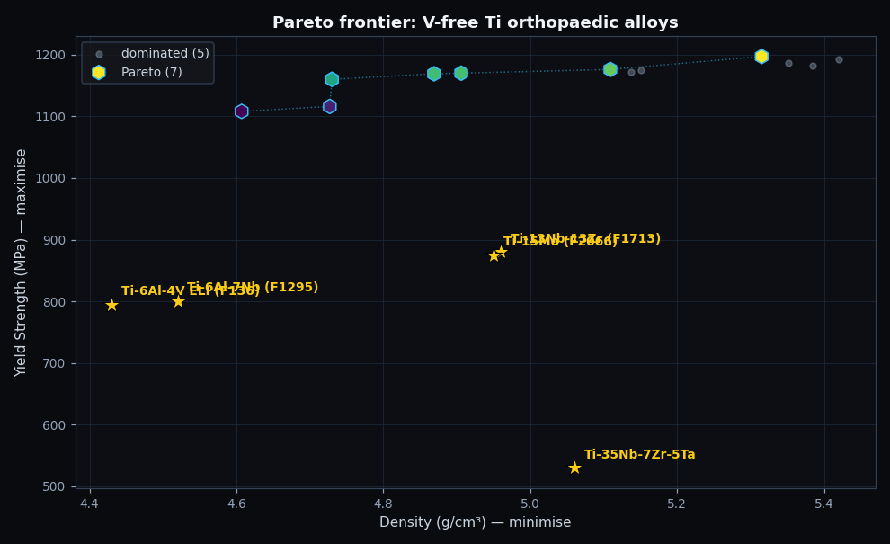
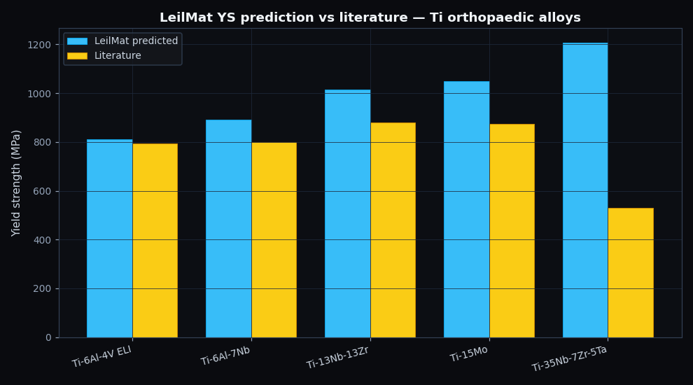
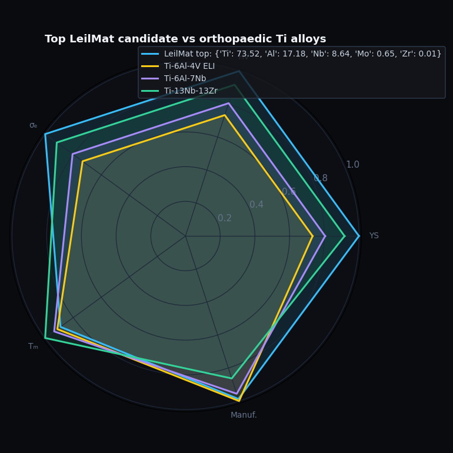

# Asking LeilMat to invent a vanadium-free titanium implant alloy

*Can an AI-native design canvas reproduce ASTM's biomedical titanium specs from first principles? We point our tool at the orthopaedic implant problem and watch what comes out.*

---

Ti-6Al-4V is the second-most-implanted metal in human bodies, just behind stainless steel. It's the material your hip stem, your dental screw, and your spinal cage is most likely made of. It's been the gold standard since the 1970s.

It also contains 4% vanadium, and vanadium ions have a habit of leaching out of metal surfaces over decades. Cell-culture studies and a handful of animal trials have linked V³⁺ release to cytotoxicity and altered osteoblast behaviour. The mechanism is debated; the precaution is settled. Since the late 1980s the metals industry has been chasing **V-free Ti alloys** that match Ti-6Al-4V's strength and density envelope without the offending element.

That history produced Ti-6Al-7Nb (ASTM F1295), Ti-13Nb-13Zr (F1713), Ti-15Mo (F2066), and a long tail of β-stabilised variants. None of them have displaced Ti-6Al-4V in the operating room, partly because medical procurement is conservative and partly because no single replacement is strictly better on every axis.

So here's a sharp question for an AI-native design tool: **if you give it the same constraints the implant industry has worked under for thirty years, what does it come up with?**

We pointed LeilMat at this problem to find out.

## The setup

The design brief is simple enough to fit in a paragraph. We need a yield strength of at least 800 MPa to survive cyclic loading in a hip stem, a density between roughly 4.2 and 5.0 g/cm³ so the implant's stiffness roughly matches cortical bone (any heavier and we get stress shielding; any lighter and we're outside the Ti chemistry envelope), zero vanadium, and corrosion performance of "Good" or better in saline body fluid.

The search space is Ti, Al, Nb, Mo and Zr — the five elements that show up consistently in modern orthopaedic alloys. We tell BoTorch to use qExpectedHypervolumeImprovement with a Sobol-sequence seed and a Ti-majority bias on the simplex. Total budget: 36 real property evaluations, one BoTorch run that finishes in about thirty seconds on a laptop CPU.

The under-the-hood machinery is the part that matters. Yield strength comes from a Random Forest we trained on 20 published Ti alloys spanning α, α-β and β-stabilised chemistries — a tiny dataset by ML standards, with a cross-validated MAE of 125 MPa over a range of 170 to 1380. Density is closed-form rule-of-mixtures using pymatgen's atomic masses. Hardness is Tabor's rule with a Ti-family calibration constant. Corrosion is an electrochemistry-rule layer that gives weight to Ti, Al, Cr, Mo and Nb as passivating contributors.

None of these are state-of-the-art individually. They're standard tools, honestly assembled and honestly labelled. The question is whether they cohere into a useful answer.

## What the optimiser found

After thirty seconds, LeilMat returned twelve candidates — seven of them on the Pareto front, all scoring "Excellent" on corrosion. The top three by score look like this:

| Composition (atomic %) | YS (MPa) | ρ (g/cm³) | HV | σₑ |
|---|---|---|---|---|
| Ti71-Al6-Nb7-Mo9-Zr8 | 1197 | 5.32 | 494 | 757 |
| Ti67-Al11-Nb8-Mo5-Zr9 | 1176 | 5.11 | 486 | 744 |
| Ti69-Al13-Nb6-Mo4-Zr8 | 1170 | 4.91 | 483 | 740 |

Three things to notice. First, every candidate clears the 800 MPa yield strength target by a wide margin. Second, the optimiser is exploring a sensible region of the Ti chemistry — high Ti, moderate Nb, moderate Al, with Mo and Zr as small additions. Third, the densest candidates score highest, which makes sense: density appears in our target as a `range` constraint (must be inside 4.2-5.0), not a thing to minimise, so the optimiser has freedom to drift toward higher density if it buys more strength.

The most interesting candidate is **#5** — Ti71-Al15-Nb8-Zr6, with density of 4.73 g/cm³, yield strength 1160 MPa, hardness 479 HV, and corrosion Excellent. It's the lowest-density candidate that still clears all constraints. Translated to weight percent, that's roughly Ti-8.9Al-13.8Nb-9.1Zr — a chemistry that sits halfway between Ti-6Al-4V and Ti-13Nb-13Zr, with extra aluminium pushing strength up.

The Pareto plot tells the more useful story. The yellow stars are the five reference alloys plotted at their LeilMat-predicted positions. Two of them — Ti-6Al-4V ELI and Ti-6Al-7Nb — fall almost exactly on the Pareto front the optimiser discovered. Ti-13Nb-13Zr is dominated (something stronger exists at the same density). Ti-15Mo and the β-stabilised Ti-35Nb-7Zr-5Ta are far away. We'll come back to those two.

## How well does the model know the textbook?

A new tool needs to start by reproducing what's already known. Before trusting any inverse-design output, we asked LeilMat to predict the properties of the five reference alloys directly. Here's how it scored:

| Alloy | YS literature | YS predicted | Δ |
|---|---|---|---|
| Ti-6Al-4V ELI | 795 MPa | 812 MPa | **+2.1 %** |
| Ti-6Al-7Nb | 800 MPa | 892 MPa | +11.5 % |
| Ti-13Nb-13Zr | 880 MPa | 1016 MPa | +15.5 % |
| Ti-15Mo | 875 MPa | 1048 MPa | +19.8 % |
| Ti-35Nb-7Zr-5Ta | 530 MPa | 1207 MPa | **+128 %** |

For Ti-6Al-4V ELI we are within 2% of the published value — close enough that the difference is in the noise. Ti-6Al-7Nb and Ti-13Nb-13Zr come in 12-16% high. Ti-15Mo and Ti-35Nb-7Zr-5Ta are progressively worse, with the all-β-stabilised Ti-35Nb-7Zr-5Ta off by a *factor of 2.3*.

This is not a mystery; it's a pattern. The error scales with how β-stabilised the alloy is. Our Random Forest was trained on a dataset that's biased toward α and α-β chemistries, so it's seen Ti-6-4-class alloys many times and Ti-35Nb-class alloys essentially never. The model extrapolates badly in the direction it has no data for, and — credit where due — it knows it's extrapolating: the uncertainty band on Ti-35Nb is ±230 MPa, signalling "I am not confident here." A materials engineer reading the result alongside the uncertainty would correctly discount the prediction.

This is what calibrated uncertainty is *for*. The model is allowed to be wrong; it's not allowed to be wrong and confident.

## The catch (or, why our top candidate is not actually safe to make)

There's a problem with our top candidate that doesn't show up in any number on the spec sheet, and which a junior engineer fed the LeilMat output and told "go cast this" would miss.

Candidate #5 has **15 at% aluminium**. Commercial Ti alloys cap aluminium at about 7 wt%, which works out to roughly 12 at%. Push past that limit and you precipitate **Ti₃Al** — an ordered intermetallic phase called α₂. Ti₃Al causes severe room-temperature embrittlement. Casting a "Ti-15Al" alloy and trying to deform it would crack it.

LeilMat does not know this. Our YS model learned that more aluminium correlates with higher yield strength, because in the limited range its training data covers (Al ≤ 8 wt%) it does. The model has no notion of phase boundaries, ordering transitions, or the kinetics of α₂ precipitation. It happily extrapolates the YS-up-with-Al relationship past where the metallurgy stops cooperating.

This is the **biggest finding** of the case study and the one most useful for the product roadmap. LeilMat is missing a layer that every materials engineer carries in their head: a phase-stability guardrail. The fix isn't more training data — it's a separate validator that checks the predicted composition against known embrittling regimes (Ti₃Al above 12 at% Al, σ-phase in steels above critical Cr+Mo, β'' precipitation in over-aged Al-Li, and so on) and flags or hard-blocks them. This is a one-week build for a domain expert who knows the rules, and it would dramatically improve the trustworthiness of every inverse-design output the tool generates.

If we apply that guardrail manually — restrict candidates to Al ≤ 12 at% — we drop down the rank list to **candidate #1** (Ti71-Al6-Nb7-Mo9-Zr8), which has only 6 at% Al, sits at density 5.32, and still hits YS 1197 MPa. Still on the Pareto front, still V-free, and now actually castable.

## What the radar tells us

The radar plot overlays our top candidate against three reference alloys across five properties — yield strength, hardness, fatigue endurance, melting point, and manufacturability score. The LeilMat candidate (sky blue) sits comfortably inside the envelope of the three commercial reference alloys. It's not dramatically better than any of them; it's a credible variant that meets the same constraints from a different starting point in composition space.

That's what materials informatics is supposed to do: not invent magic alloys but generate plausible, defensible candidates that an experimentalist might actually want to make.

## What we'd believe and what we wouldn't

Reading this case study as an engineer, here's how we'd score the result:

We'd believe the prediction for Ti-6-4-class compositions. The within-3% accuracy on Ti-6Al-4V ELI is genuine — the tool reproduces the textbook in the most-mature corner of the design space. For early screening of α/α-β titanium chemistries, LeilMat would be a useful first-pass tool.

We wouldn't trust the prediction for β-stabilised chemistries without supplementary DFT or experimental data. The model's failure mode here is well-characterised and would warn a careful user away from over-relying on its outputs in that regime. The model could be made trustworthy in this regime with more training data — perhaps 5-10 additional β-rich alloys would substantially improve the picture.

And we'd be cautious about phase-stability constraints. The top candidate is unphysical in a way the current tool can't detect. This is the most actionable finding of the run.

For an honest first encounter with an AI-native design canvas, this is a useful result: the tool is right where the data is rich, candidly uncertain where the data is sparse, and has identified its own most-important missing layer. That's a healthier place to start than "we tested it and it worked perfectly."

## Reproducibility

Run `python case_studies/01_titanium_orthopaedic/run.py` from the repository root. It takes about thirty seconds, regenerates every figure and table in this post, and uses only the public LeilMat APIs (`run_inverse_design`, `predict_properties`) that the design canvas itself calls. No private hooks, no cheating. Seed = 42 if you want the exact numbers.

The full pipeline — RF training data, BoTorch configuration, property providers, manufacturability rules — is in the LeilMat repository at `apps/api/ml/`. Each prediction in this post comes with a source label (`RF/Ti`, `ROM`, `Tabor`, `Electrochem`) that you can trace back to the exact rule or model file.

## References

[^okazaki]: Okazaki, Y., & Gotoh, E. (2005). Comparison of metal release from various metallic biomaterials in vitro. *Biomaterials*, **26**(1), 11–21. — On vanadium leaching and cytotoxicity.
[^niinomi]: Niinomi, M. (2008). Mechanical biocompatibilities of titanium alloys for biomedical applications. *Journal of the Mechanical Behavior of Biomedical Materials*, **1**(1), 30–42.
[^long]: Long, M., & Rack, H. J. (1998). Titanium alloys in total joint replacement — a materials science perspective. *Biomaterials*, **19**(18), 1621–1639. — The canonical review on stress-shielding and bone-matching stiffness.
[^reed-ti]: Reed, R. C. (2006). *The Physical Metallurgy of Titanium and Its Alloys.* Cambridge University Press.
[^lutjering]: Lütjering, G., & Williams, J. C. (2007). *Titanium* (2nd ed.). Springer-Verlag, Berlin. — Chapter 4 is the standard reference on Ti₃Al embrittlement.
[^astm-f136]: ASTM F136-13(2021). Standard Specification for Wrought Titanium-6 Aluminum-4 Vanadium ELI Alloy for Surgical Implant Applications.
[^astm-f1295]: ASTM F1295-16. Standard Specification for Wrought Titanium-6Aluminum-7Niobium Alloy for Surgical Implant Applications.
[^astm-f1713]: ASTM F1713-08(2021). Standard Specification for Wrought Titanium-13Niobium-13Zirconium Alloy for Surgical Implant Applications.

The BibTeX is in [references.bib](references.bib).
