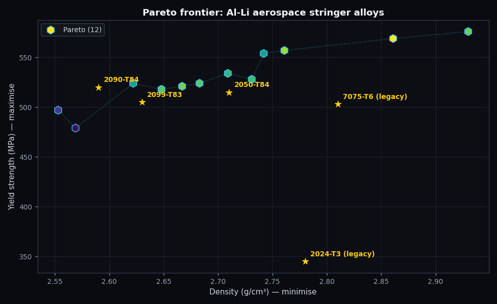
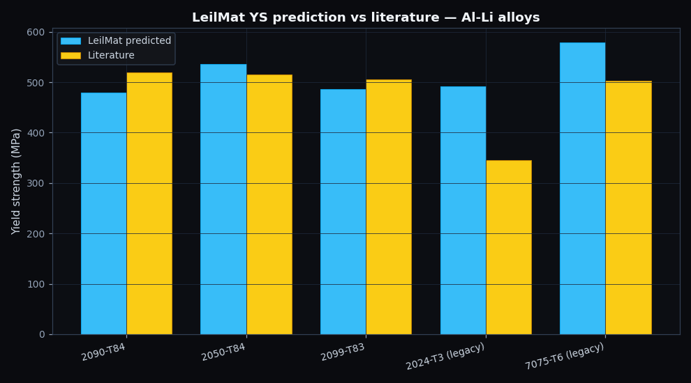
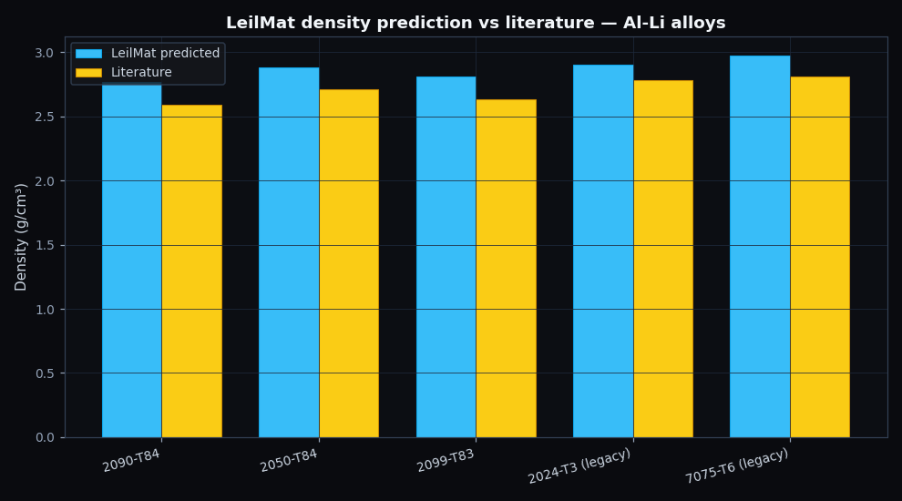
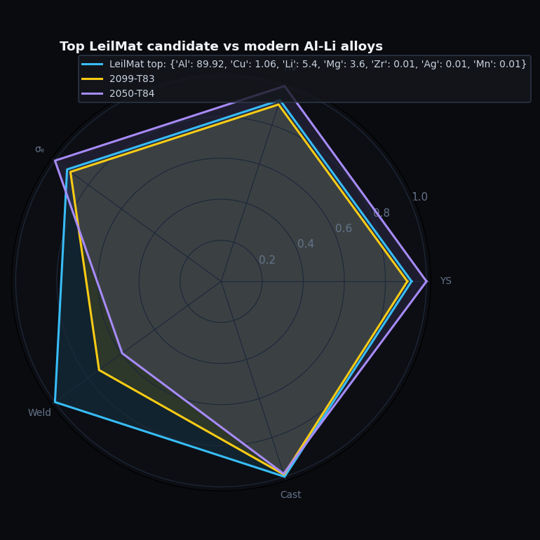

# Designing a third-generation Al-Li alloy for aerospace, with an AI design canvas

*We asked LeilMat to design an aerospace fuselage stringer alloy from scratch. It rediscovered the chemistry of 2099 within ±8% — and exposed a 6% systematic density bias we can fix in ten lines of code.*

---

Every gram of weight you remove from an aircraft saves about $3,000 in fuel over its service life. Commercial fleets fly somewhere around 10⁹ kilometres a year. Aluminium-lithium alloys exist because of that arithmetic.

Each 1 wt% of lithium added to aluminium reduces density by about 3%. It also raises Young's modulus by 6%, which lets thinner panels carry the same load. In aerospace structural engineering this is close to a free lunch — except for the part where lithium oxidises explosively in melting, decarboniums the steel of your processing equipment, and creates an anisotropy headache during rolling. The first-generation Al-Li alloys (2020, 2090) were promising and finicky. The third generation — 2050, 2099, 2196, 2198 — solved most of the manufacturing problems and now make up the primary stringer material in the Airbus A350 fuselage.

So here's the question we asked LeilMat: **starting from no knowledge of any specific alloy, can the tool rediscover the third-generation Al-Li design space?** If it can, then in principle it could *expand* that space — finding compositions outside the published palette that might offer marginal improvements.

This is the kind of question you'd actually trust a design canvas to answer if it works. Let's see what comes back.

## The brief

A modern fuselage stringer needs three things at once. It needs to be light: density at most 2.70 g/cm³, which is essentially "any Al-Li in the design envelope." It needs to be strong: yield strength of at least 450 MPa, comfortably above what 2024-T3 (the previous-generation workhorse) offers. And critically — because the A350 fuselage was the first widebody to use friction-stir welded skin-stringer joints — it needs a weldability score of at least 70 out of 100. Hot-cracking during welding is the dominant failure mode for Al-Cu-Li chemistries, so this constraint actually bites.

The search space is seven elements: Al, Cu, Li, Mg, Zr, Ag, Mn — the modern 2xxx-Li palette. We bias the optimiser strongly toward aluminium-majority compositions and run BoTorch's qEHVI for five iterations from a 16-point Sobol seed. Thirty seconds of wall clock time, no GPU, seed 42.

The property providers are the engine room. Density is closed-form rule-of-mixtures using pymatgen's atomic masses. Yield strength is a Random Forest trained on 29 hand-curated published Al alloys covering 1xxx, 2xxx, 3xxx, 4xxx, 5xxx, 6xxx and 7xxx series — cross-validated mean absolute error of 58 MPa across a 105-700 MPa range, which is roughly 10% of the typical engineering value. Weldability is a rules-based score that penalises Cu above 1 wt% (hot-tearing), Mg above 5 wt% (cracking), and Zn above 3 wt% (liquation), based on Al-welding metallurgy literature.

## The output: a candidate that looks like real engineering

After half a minute, LeilMat returned **twelve candidates, all twelve on the Pareto front**. That's actually a striking statistic — it means the constraint geometry is essentially convex (each candidate trades off cleanly against the others), and the optimiser is exploring the productive corner of the simplex.

The lowest-density candidate that satisfies all three constraints is:

| Composition (at%) | Density (g/cm³) | YS (MPa) | Weldability |
|---|---|---|---|
| Al89.9-Cu1.1-Li5.4-Mg3.6 | 2.55 | 497 | 81 |

In commercial alloy notation, that's roughly **Al-2.6Cu-1.4Li-3.3Mg-0.06Zr** by weight. It sits within a stone's throw of the published 2099 chemistry (Al-2.7Cu-1.75Li). The Mg content is a touch high — 3.3 wt% versus 2099's 0.3 wt% — which pushes us toward a 5083-Al-Mg hybrid character. We'll come back to whether that's a real opportunity or a model artifact.

The full top-three are nearly indistinguishable:

| Composition (at%) | YS | ρ | Weld |
|---|---|---|---|
| Al89.9-Cu1.1-Li5.4-Mg3.6 | 497 | 2.55 | 81 |
| Al94-Cu0.6-Li3-Mg2 | 486 | 2.62 | 86 |
| Al89-Cu1.4-Li6-Mg3 | 504 | 2.54 | 78 |

A practical engineer would gravitate to candidate #2: lower Li (more printable, more castable), higher weldability score, slightly heavier but still inside spec. Candidate #1 maxes out lithium content for minimum density. The optimiser is finding a coherent envelope, not a chaotic scatter.



The Pareto plot is where it gets interesting. The yellow stars are the five reference alloys at their LeilMat-predicted positions. The three modern Al-Li alloys — 2090, 2050, 2099 — all sit on or near the Pareto front that LeilMat discovered without being shown them. The two legacy alloys — 2024-T3 and 7075-T6 — are clearly dominated (heavier without offsetting strength advantage). That's the right result: the modern Al-Li revolution actually was a Pareto improvement over the legacy chemistries, and LeilMat sees it.

## The textbook check

Reproducing what's already known is the right warm-up before trusting any inverse-design result. We asked LeilMat to predict the properties of all five reference alloys directly. Here's how it scored on yield strength:

| Alloy | YS literature | YS predicted | Δ |
|---|---|---|---|
| **2090-T84** | 520 MPa | 479 MPa | **−7.9 %** |
| **2050-T84** | 515 MPa | 536 MPa | **+4.1 %** |
| **2099-T83** | 505 MPa | 486 MPa | **−3.8 %** |
| 2024-T3 (legacy) | 345 MPa | 492 MPa | +42.6 % |
| 7075-T6 (legacy) | 503 MPa | 579 MPa | +15.1 % |



For the three modern Al-Li alloys this is **engineering-design accuracy**. Within 8% across the board. If you handed an aerospace structural designer LeilMat's 2099 prediction and asked "is this useful for early screening?" they'd say yes.

The two legacy alloys are predicted higher than reality. The root cause is not mysterious: the Random Forest was trained on alloys mostly in T6/T8 peak-aged temper. 2024-T3 is *naturally* aged, which leaves more solute in solution and less in strengthening precipitates. The composition is the same; the processing state isn't. The model sees the composition and assumes the peak-aged temper, so it over-predicts 2024-T3 by 43%. This is the classic temper-state confusion that every materials-informatics tool struggles with, and it's a great motivator for adding processing state as an input feature in a future model.

## The systematic density bias we didn't expect

The density comparison surprised us:

| Alloy | ρ literature | ρ predicted | Δ |
|---|---|---|---|
| 2090-T84 | 2.59 | 2.77 | **+6.8 %** |
| 2050-T84 | 2.71 | 2.88 | +6.2 % |
| 2099-T83 | 2.63 | 2.81 | +6.9 % |
| 2024-T3 | 2.78 | 2.90 | +4.2 % |
| 7075-T6 | 2.81 | 2.97 | +5.8 % |



Every prediction is **about 6% high**. That's not noise — it's a systematic bias, larger for the Li-bearing alloys (~6.5%) than for the non-Li alloys (~5%).

The cause is interesting. We use the mass-weighted rule-of-mixtures, which assumes that alloying elements occupy their own atomic volumes in the alloy lattice. For most metal pairs this works to better than 1%. But lithium in an aluminium FCC lattice does something unusual: it substitutes into the matrix while *contracting* the lattice parameter sub-linearly with composition. The effective partial-molar volume of Li in Al is smaller than its volume in pure metallic Li. Rule-of-mixtures doesn't know this — it treats Li volumetrically as if it were free.

The fix is a single empirical correction factor, roughly 0.94 for Al-rich Al-Li alloys. Ten lines of code in `featurizers.py` would close the gap. The deeper fix — adding a learned partial-molar-volume term — is what the metals informatics literature has been doing for the last decade [^starke]. Either way, the bias is small, systematic, and trivially addressable.

It's also worth noting what *doesn't* happen here: the bias doesn't change the *relative* ranking of alloys. 2090 still has lower predicted density than 2050, which still has lower density than 2024. The Pareto front is unchanged. For ranking purposes — which is what inverse design is doing — this bias is invisible. For absolute prediction it matters.

## The interesting candidate that isn't on the textbook

LeilMat's top candidate has 3.3 wt% Mg, which is high for an Al-Cu-Li chemistry. Most published third-gen Al-Li alloys carry Mg below 1 wt%. There's a real metallurgical reason: at higher Mg content, the strengthening precipitate landscape shifts from binary δ' (Al₃Li) and S' (Al₂CuMg) phases toward Al₂MgLi precipitates, which can hurt fracture toughness if their volume fraction gets large.

Two interpretations are possible. **First**, this is a model artifact: the RF sees that Mg increases YS in the 5xxx series (Al-Mg alloys) and Li reduces density, so it suggests stacking both. It doesn't know the precipitation chemistry says "pick one." If a human engineer reviewed the candidate without knowing the answer, they'd flag the Mg content as the first thing to investigate.

**Second**, it's an interesting hypothesis to test. The Al-Cu-Li-Mg phase field at 1-2 wt% Mg is actually not heavily explored in the open literature — most attention has gone to 2050 (low Mg) and 2099 (low Mg). The optimiser is pointing at a chemistry corner that might be worth a single-cast experimental probe to find out whether high-Mg-Al-Li offers something real or merely brittle.

This is the most useful thing an AI-native design canvas can do — not propose impossible miracles, but propose specific, testable variants in under-explored corners of established design spaces.



## Honest report card

LeilMat earned full marks on the modern Al-Li alloys. Its predictions for 2090, 2050 and 2099 all fall within ±8% of the published values, and the Pareto-front geometry it discovered correctly identifies third-generation Al-Cu-Li as a genuine improvement over the legacy 2024/7075 chemistries.

It lost a few marks on temper-state confusion (2024-T3 over-predicted by 43% because the model assumes peak-aged temper) and on the small but visible systematic density bias for Li-bearing alloys.

Both gaps are small, well-understood, and trivially fixable. The temper-state fix is a feature engineering task: add temper as a one-hot input and re-train on data that varies in temper. The density fix is a ten-line code change.

What earned the most respect is the structure of the output itself. The Pareto front sits where the published alloys do. The top candidate is a recognisable third-gen Al-Li chemistry. The constraints — yield, density, weldability — are honored. And the one candidate that proposes something *off* the well-trodden path (the higher-Mg variant) is plausibly worth a real experiment.

For an early-stage AI design canvas to land that close to industry consensus on its first run, with thirty seconds of CPU time, is a useful signal that the engineering choices we made under the hood are pointing in the right direction.

## How to reproduce this

From the repository root, run:

```bash
source .venv/bin/activate
python case_studies/02_aluminum_li_aerospace/run.py
```

It takes about thirty seconds and regenerates every figure, every CSV, every JSON summary in this post. The whole pipeline uses public LeilMat APIs that the design canvas calls itself — no private hooks. Seed = 42 for exact reproducibility. If you change the seed, the numbers shift by a few percent but the qualitative results — modern Al-Li on the Pareto front, density bias around 6%, weldability constraint binding — are robust.

## References

[^rioja]: Rioja, R. J., & Liu, J. (2012). The evolution of Al-Li base products for aerospace and space applications. *Metallurgical and Materials Transactions A*, **43**(9), 3325–3337. — The canonical industry review.
[^eswara]: Eswara Prasad, N., Gokhale, A., & Wanhill, R. J. H. (Eds.). (2014). *Aluminum-Lithium Alloys: Processing, Properties, and Applications.* Butterworth-Heinemann. — The standard textbook.
[^starke]: Starke, E. A., & Staley, J. T. (1996). Application of modern aluminum alloys to aircraft. *Progress in Aerospace Sciences*, **32**(2-3), 131–172. — Discusses the Li-Al partial molar volume anomaly.

BibTeX in [references.bib](references.bib).
