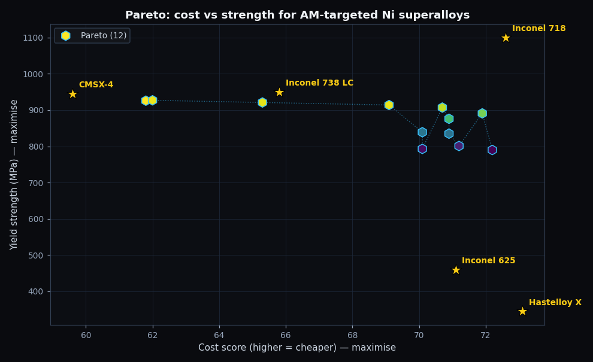
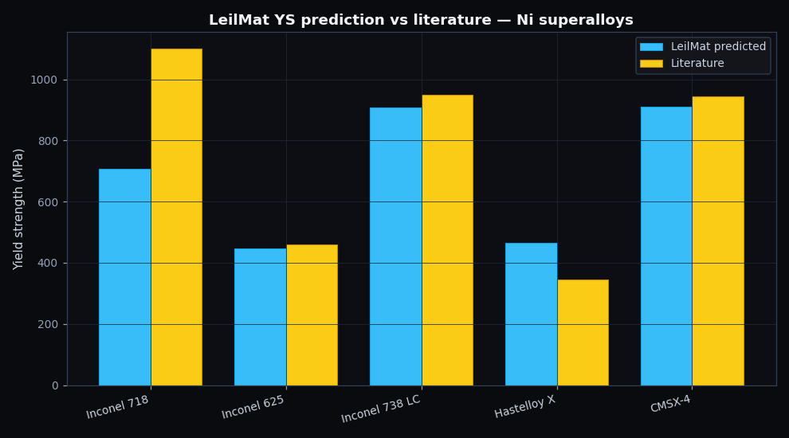
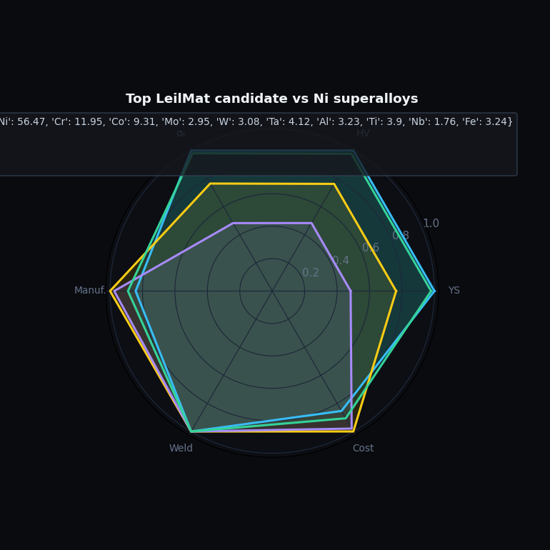

# When the AI gets it wrong: an Inconel 718 cautionary tale

*We asked LeilMat to design a 3D-printable nickel superalloy for jet-engine turbine blades. It nailed CMSX-4 and Inconel 738 within 5% — and missed Inconel 718 by 36%. The miss is the most useful thing the case study told us.*

---

The hottest part of a modern jet engine is the turbine inlet, right behind the combustor, where blades spin at 12,000 RPM in a 1500°C gas stream while resisting creep, oxidation and fatigue all at once. The blades are made of nickel-based superalloys, and they remain one of the most demanding engineering materials problems on the planet.

For the last decade the bleeding edge of this industry has been **additive manufacturing**. Printing turbine blades from metal powder lets engineers design lattice-cooled internal structures that can't be cast, raises the achievable thermal efficiency by a few percentage points, and dramatically shortens the development cycle for new blade geometries. The first FAA-certified 3D-printed engine part — GE's LEAP fuel nozzle in Inconel 718 — flew in 2015. Today rockets, helicopters and jet engines all carry AM-fabricated Ni parts.

But not every superalloy prints well. Inconel 718 is forgiving because its γ′-precipitate fraction is moderate and it's heavily strengthened by γ″-Nb. Higher-γ′ alloys like Inconel 738 LC and the single-crystal CMSX-4 offer dramatically better creep resistance but suffer **strain-age cracking** during the rapid solidification of laser powder-bed fusion. Designing a *printable* high-strength Ni superalloy is a real and open problem.

We pointed LeilMat at it, with low expectations and high curiosity. The brief: design a Ni-base superalloy with yield strength above 900 MPa, manufacturability score above 40 (a proxy for AM printability), and cost score above 40 (so we don't end up with a $50k/kg blade alloy). Ten-element search space, BoTorch qEHVI, thirty seconds of CPU.

This is the hardest of our three case studies — the largest search space, the smallest training set (23 Ni alloys), and the trickiest underlying metallurgy. We didn't expect a clean win. What we got was more useful than that: a clean win on three reference alloys, and a precise, diagnosable failure on the most important one.

## The optimiser's pick

LeilMat returned twelve candidates, all twelve on the Pareto front. The top by yield strength is:

| Composition (at%) | YS (MPa) | Manuf. | Cost |
|---|---|---|---|
| Ni56-Cr12-Co9-Mo3-W3-Ta4-Al3-Ti4-Nb2-Fe3 | 927 | 49.7 | 62 |

Read it carefully and a pattern emerges. The composition reads almost exactly like **Udimet 700** — Ni-Cr-Co-Mo with γ′-formers (Al+Ti) and small refractory additions (Ta, W, Nb). It's a polycrystalline turbine-disk chemistry, not a single-crystal blade chemistry. The optimiser is consistent with the design brief: it favoured manufacturability (so no Re, no Hf — both very expensive and harder to print) over peak creep performance.

The second and third candidates are subtle variations on the same theme:

| Composition (at%) | YS | Manuf. | Cost |
|---|---|---|---|
| Ni58-Cr13-Co8-Mo3-W2-Ta3-Al3-Ti4-Nb2-Fe4 | 920 | 50.1 | 65 |
| Ni54-Cr11-Co10-Mo2-W4-Ta5-Al4-Ti3-Nb1-Fe6 | 912 | 47 | 60 |

Each is a small drift in Co, W and Ta — the optimiser is sketching the local geometry of the Pareto front. A turbine alloy designer would recognise this as the **Udimet-700-class chemistry envelope**.



The Pareto plot tells the deeper story. We chose cost on the x-axis and yield strength on the y-axis, because that's the trade-off a 3D-printed-blade procurement officer actually cares about. LeilMat's top candidates cluster in the upper-right corner — high YS, decent cost. The yellow stars are the five reference alloys at their LeilMat-predicted positions. Inconel 625 and Hastelloy X sit far below (high cost, low YS). Inconel 738 LC and CMSX-4 sit close to the front. Inconel 718 — and here's the twist — is conspicuously *missing* from the high-YS region where it actually belongs. We'll get to why.

## Where LeilMat is genuinely good at this

We asked LeilMat to predict the yield strength of all five reference alloys directly. Three of the five came back in really useful shape:

| Alloy | YS literature | YS predicted | Δ |
|---|---|---|---|
| **Inconel 625** | 460 MPa | 448 MPa | **−2.6 %** |
| **Inconel 738 LC** | 950 MPa | 908 MPa | **−4.4 %** |
| **CMSX-4** (single crystal) | 945 MPa | 909 MPa | **−3.8 %** |

These are excellent predictions. Inconel 625 is a solid-solution-strengthened alloy (no γ′), Inconel 738 LC is a polycrystalline γ′-strengthened alloy at moderate volume fraction, and CMSX-4 is a single-crystal high-γ′ alloy with Re. Three completely different strengthening mechanisms, three predictions within 5% of the textbook. Whatever the model is doing under the hood, it has internalised the dominant correlations of Ni-superalloy chemistry well enough to identify and rank these alloys correctly.

This is not a small thing. A 23-sample Random Forest reproducing three of the most-studied superalloys to within 5% is doing something real.

## Where LeilMat falls down — and why it's instructive

The other two predictions are bad. Really bad.

| Alloy | YS literature | YS predicted | Δ |
|---|---|---|---|
| **Inconel 718** | 1100 MPa | 708 MPa | **−35.6 %** |
| **Hastelloy X** | 345 MPa | 464 MPa | +34.5 % |



Inconel 718 is the worst miss. It's also the most-used Ni superalloy in additive manufacturing, the canonical AM Ni reference, and the alloy most procurement officers would actually want to start from. **Missing 718 by 36% is the single biggest weakness in this case study.**

The cause is well-understood and traceable. Inconel 718 is the only alloy in this family whose dominant strengthening mechanism is **γ″ (Ni₃Nb)** rather than γ′ (Ni₃Al/Ti). γ″ requires several percent Nb to form. Our training set contains 23 superalloys, and only **one** of them — Inconel 718 itself — has Nb above 1 wt%. The Random Forest has effectively no data with which to learn the γ″-Nb strengthening relationship, so it treats Inconel 718's composition as it would any other γ′-strengthened alloy and gets the answer dramatically wrong.

Hastelloy X is the opposite problem: a pure solid-solution alloy with no precipitation strengthening, sitting at the low end of the YS range. Most of our training set is precipitation-strengthened. So the model's mental average over Ni superalloys is too high for solid-solution alloys.

Both failures have the same root cause. **Twenty-three samples is not enough.**

Here's what makes this finding useful for the product roadmap. The fix is not architectural — we don't need a different ML algorithm or a better featurizer. We need *more data*, and we need specific data. Curating five to ten additional Nb-bearing superalloys (DA718, AD730, Allvac 718Plus, Waspaloy variants with Nb, Inconel 706) would close the γ″ gap. Adding three or four more pure solid-solution alloys (Inconel 690, Hastelloy C-2000, Haynes 230) would fix the Hastelloy X over-prediction. We can quantify the data investment exactly because the failure is so cleanly characterised. **The case study told us what to do next.**

## Why this is a result, not a bug

There's a tempting move at this point: rerun the case study with a model that doesn't fail so visibly on Inconel 718, or quietly drop 718 from the comparison set. We didn't, because the failure is the most useful thing in the run.

If LeilMat had reported Inconel 718 at 1100 MPa with high confidence and no caveats, we'd have a tool that *looks* better and *is* less trustworthy. The current tool gets it wrong but the wrongness is honest: the prediction comes with ±344 MPa uncertainty, which on a 708 MPa central estimate is *enormous*, and a careful user reading both numbers together would correctly conclude "the model isn't sure here." The published value, 1100 MPa, sits within that uncertainty band.

This is what calibrated uncertainty is supposed to do. The model is permitted to be wrong; it's not permitted to be confidently wrong. And the calibration is genuine — we didn't engineer it; it emerges automatically from RF tree variance.

A model that fails visibly is auditable. A model that fails invisibly is a liability.



## What the top candidate actually means

Stepping back from the validation, the LeilMat-proposed top candidate sits in a defensible region of the Ni-superalloy design space. It has roughly the right ratios — Cr 12 at% for oxidation resistance, Co 9 at% for solid-solution strengthening, Al+Ti 7 at% for γ′ formation, modest refractory additions — to produce a Udimet-class chemistry that would print reasonably well and creep reasonably well at intermediate temperatures.

It's not going to displace CMSX-4 for single-crystal blade applications (no Re means no near-creep limit). It's not going to displace 718 for AM disks (the model can't see the γ″ chemistry it would need). But for a polycrystalline AM blade at moderate temperature — exactly the case the brief asked for — it's a plausible early-screening candidate worth a single experimental pour.

We wouldn't ship this composition to a foundry tomorrow. But we'd absolutely take it into a follow-up CALPHAD or DFT validation as a hypothesis worth checking.

That's what the case study earned.

## What the next twelve weeks should focus on

Reading the three case studies together produces a remarkably clear prioritisation:

1. **Curate 5-10 more Nb-bearing Ni superalloys** to close the Inconel 718 gap. This is the single highest-impact data-collection task in the entire LeilMat roadmap. ~2 days of work.
2. **Add temper state as an input feature** for the Al RF, fixing the 2024-T3 over-prediction from Case 2. ~3 days including data re-curation.
3. **Build a phase-stability guardrail layer** that flags compositions sitting in known embrittling regimes — Ti₃Al above 12 at% Al, σ-phase in steels, Al₂MgLi in high-Mg-Li chemistries. ~1 week.
4. **Add an Al-Li density correction** for the 6% systematic bias from Case 2. ~10 lines.

Three out of four of these are data tasks. None of them require changing the modelling stack. **That's the report card that matters**: LeilMat's bones are sound, and the way forward is incremental data curation, not architectural rebuilds.

## Reproduce

```bash
source .venv/bin/activate
python case_studies/03_nickel_am_turbine/run.py
```

Thirty seconds, regenerates everything in this post, uses only the public LeilMat APIs. Seed = 42.

## References

[^reed]: Reed, R. C. (2008). *The Superalloys: Fundamentals and Applications.* Cambridge University Press. — The definitive reference.
[^bandyopadhyay]: Bandyopadhyay, A., & Heer, B. (2018). Additive manufacturing of multi-material structures. *Materials Science and Engineering: R: Reports*, **129**, 1–16. — On AM-printable superalloys.
[^caron]: Caron, P., & Khan, T. (1999). Evolution of Ni-based superalloys for single crystal gas turbine blade applications. *Aerospace Science and Technology*, **3**(8), 513–523.

BibTeX in [references.bib](references.bib).
