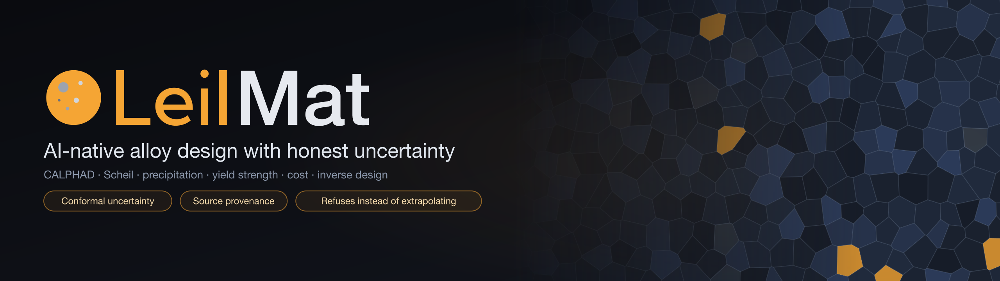

# LeilMat documentation

LeilMat is an AI-native alloy design platform. One API and one canvas cover phase equilibria
(CALPHAD), solidification (Scheil), precipitation kinetics, yield strength, formation energy, cost
and multi-objective inverse design — and every number it returns says where it came from and how
far to trust it.

What sets it apart is what it refuses to do. It returns **conformal uncertainty intervals**, tags
every value with its **source**, **refuses instead of extrapolating**, and ships a **validation
scorecard whose checks are able to fail**.

## Where to start

| I want to… | Read |
|---|---|
| Run it on my machine | [Getting started](getting-started.md) |
| Understand how it works and why it refuses things | [Architecture](architecture.md) |
| See how accurate it is, and how that's measured | [Validation](validation.md) · [`SCORECARD.md`](SCORECARD.md) |
| Run Neper, SPPARKS or DAMASK simulations | [Cloud simulations](cloud-simulations.md) |
| Deploy it somewhere real | [Deployment](deployment.md) |
| Call the API | [API reference](reference/api.md) · interactive docs at `/docs` on a running server |
| Configure it | [Configuration reference](reference/configuration.md) |
| Contribute | [`CONTRIBUTING.md`](../CONTRIBUTING.md) |
| Check licences and data provenance | [`NOTICE.md`](../NOTICE.md) · [CALPHAD databases](../models/calphad_tdbs/README.md) |

## Read this before relying on a number

- **The scorecard is the source of truth.** Figures quoted in prose can lag it.
- **Some reference data is unverified.** Auditing the nickel validation set found 5 of 8 values wrong;
  the aluminium and titanium sets and the holdout sets have not had that audit yet. The formation-energy
  calorimetry references were audited and rebuilt from 12 verified values. See [Validation → Data quality](validation.md#data-quality).
- **Coverage has real gaps.** No bundled open database models stainless steels or multicomponent Ni
  superalloys, so those CALPHAD requests are refused. Yield strength is limited by small training sets
  and by processing history that a composition-and-temper label cannot capture.
- **Cloud simulations are screening tools.** Each result is labelled with a
  [`calibration`](cloud-simulations.md#trusting-the-results-the-calibration-label) tag, and none is
  claimed as validated.
- **The API is open by default** until you configure authentication; see the
  [security checklist](deployment.md#security-checklist).

## How these docs are kept honest

The two reference pages are **generated from the code** (`scripts/gen_reference_docs.py`), and a test
fails if they drift from it. Another test checks that every link in these pages resolves. The banner
above is generated by `docs/assets/build_images.py`; it is decoration, not data.
